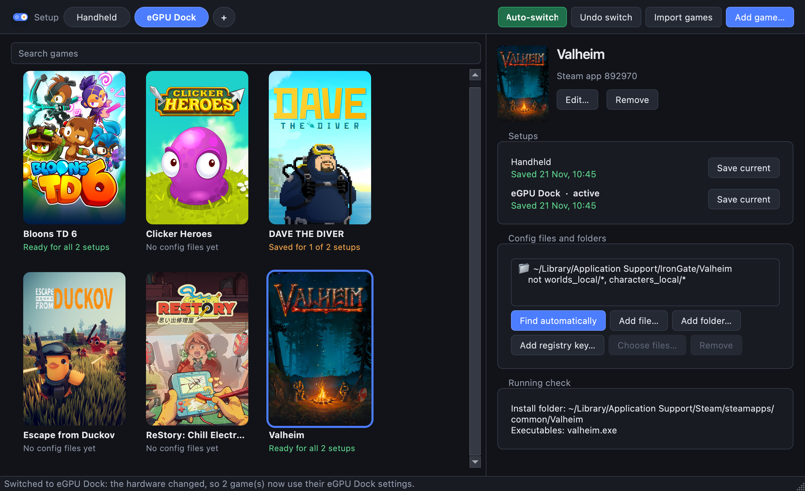
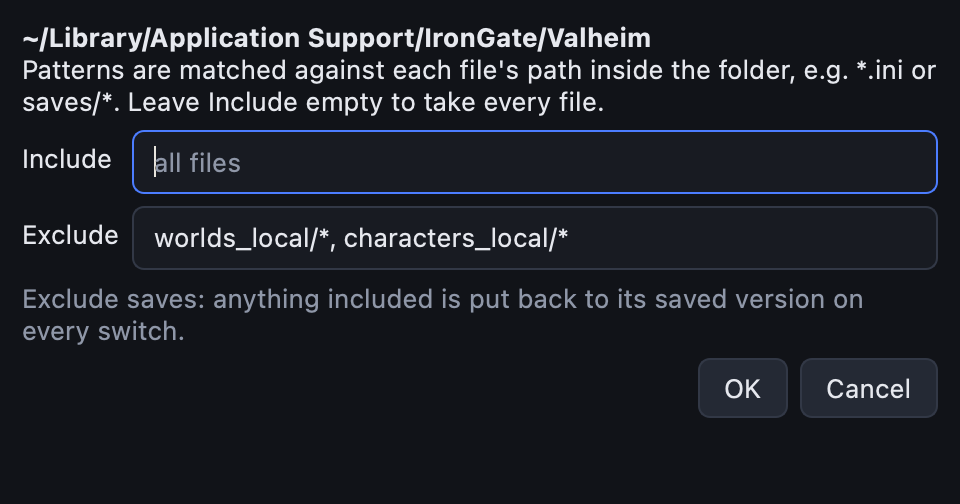

<div align="center">


# QP's Graphics Manager

**One-click graphics settings for every way you play.**

Keep a separate copy of each game's graphics settings for each hardware setup, such as a handheld, an eGPU dock or a laptop on battery, and switch all of them at once.

[](https://github.com/QPfixxy/QPs-Graphics-Manager/actions/workflows/ci.yml)


[](LICENSE)


</div>



## Why

Handheld gaming PCs and laptops are often plugged into an external GPU. Docked, you want 4K at ultra settings. On the go, you want 720p at low settings and a long battery life. Games keep only one set of graphics settings, so every change of setup means opening each game's options menu again.

QP's Graphics Manager saves each game's settings once for each setup. Pick a setup and every game's settings are swapped in one step.

## Features

- **Setups, not per-game profiles.** Define setups such as `Handheld`, `eGPU Dock` and `Laptop on Battery` once. Each game keeps one saved config per setup, and switching applies all of them together.
- **Keeps your tweaks.** When you switch away from a setup, the settings you're using are saved back into it, so changes you made while docked are still there next time you dock.
- **Finds your Steam library.** It finds every Steam library on Windows and Linux, including Flatpak Steam, and games running under Proton along with their prefix folders. Posters come from Steam's local artwork cache, or from the custom art you set in Steam.
- **Works with any game.** Add games from other launchers by hand. A config can be a single file, several files or a whole folder.
- **Safe swapping:**
  - Refuses to switch while an affected game is running.
  - Backs up every file it's about to overwrite.
  - Writes atomically, so an interrupted switch can't leave a half-written config.
  - If anything fails partway through, everything is rolled back.
  - **Undo** puts back the configs from before the last switch.
- **Protects your saves.** Some games keep save files in their config folder. Include and exclude patterns keep saves out of the snapshots, and switching never deletes files.
- **Desktop app and command line.** Everything in the app also works from the `qpgm` command, which is handy for scripts and for gaming modes without a desktop.

<p align="center">
  
  <br><sub>Choosing which files in a config folder are swapped, so saves stay untouched</sub>
</p>

## Platform support

| Platform | Status |
|---|---|
| **Windows** (x64 and ARM64) | Supported. Tested on Windows 11. |
| **Linux** | Supported. Tested on Ubuntu, including Proton prefixes and Flatpak Steam. Bazzite and SteamOS-style distros are targets; reports welcome. |
| **macOS** | Runs, but used for development only. |

## Getting started

> **Pre-release.** There are no installers yet, so run it from source. It needs Python 3.11 or newer.

```bash
git clone https://github.com/QPfixxy/QPs-Graphics-Manager.git
cd QPs-Graphics-Manager
python3 -m venv .venv
source .venv/bin/activate          # Windows: .venv\Scripts\activate
pip install -e .
qpgm gui
```

Once the app is open:

1. **Add your setups** with the **+** button, for example `Handheld` and `eGPU Dock`.
2. **Add games** with **Import Steam games**, or **Add game…** for anything else.
3. **Tell it where each game keeps its settings** with **Add file…** or **Add folder…** in the details panel. [PCGamingWiki](https://www.pcgamingwiki.com/) lists the location for most games. Automatic detection is coming (see [Roadmap](#roadmap)).
4. **Save each setup.** Set the game up for one setup, then click **Save current** next to that setup. Repeat for the next one.
5. **Switch.** Click a setup at the top and every game is updated.

### Command line

```bash
qpgm setup add "Handheld"
qpgm steam --import                                   # add installed Steam games
qpgm game add "Elden Ring" --exe eldenring.exe        # or add any game by hand
qpgm config add "Elden Ring" "%APPDATA%\EldenRing" --include "*.xml"
qpgm save "Handheld" "Elden Ring"                     # save the current settings for a setup
qpgm switch "eGPU Dock"                               # apply every game's eGPU Dock settings
qpgm undo                                             # put back the configs from before the last switch
```

Run `qpgm --help` for the full list of commands.

## Where your data lives

Saved configs and backups are stored in your user data folder and never inside game folders:

- **Windows:** `%LOCALAPPDATA%\qpgm`
- **Linux:** `~/.local/share/qpgm`

Set `QPGM_DATA_DIR` to use a different folder.

## Roadmap

- [x] **Phase 0:** Foundation: data model, storage, tests, CI on Windows and Linux
- [x] **Phase 1:** Manual switching: Steam discovery, safe swapping, desktop app
- [ ] **Phase 2:** Automatic config detection using the [Ludusavi manifest](https://github.com/mtkennerly/ludusavi-manifest)
- [ ] **Phase 3:** Automatic switching when an eGPU is connected or disconnected, or on power and display changes
- [ ] **Phase 4:** More launchers (Heroic, Lutris, GOG, Epic) and settings stored in the Windows registry
- [ ] **Phase 5:** Installers (Windows installer, AppImage, Flatpak)

See [ROADMAP.md](ROADMAP.md) for details.

## Development

```bash
pip install -e ".[dev]"
pytest              # unit, integration and GUI tests (set QT_QPA_PLATFORM=offscreen on a headless machine)
ruff check .        # lint
```

```
src/qpgm/
  core/     data model, Steam discovery, artwork, safe swapping (no GUI code)
  gui/      PySide6 desktop app
  cli.py    the qpgm command
tests/
```

Bug reports and pull requests are welcome.

The original v0.1 (PyQt5) is kept on the [`legacy`](https://github.com/QPfixxy/QPs-Graphics-Manager/tree/legacy) branch.

## Related projects

- [Ludusavi](https://github.com/mtkennerly/ludusavi): game save backup. Its manifest will power automatic config detection.
- [GPUPrefSwitcher](https://github.com/sharpjd/GPUPrefSwitcher) and [Thunderbolt Switch](https://github.com/Valkirie/Thunderbolt-Switch): Windows tools that cover parts of the same problem.

## License

Copyright (C) 2025-2026 Dakota Naylor

QP's Graphics Manager is free software: you can redistribute it and/or modify it under the terms of the [GNU General Public License](LICENSE), version 3 or (at your option) any later version. In short, you may use, share and change it, but any version you distribute must also be released as open source under the GPL. It comes with no warranty.
